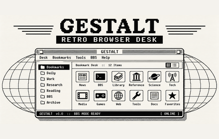
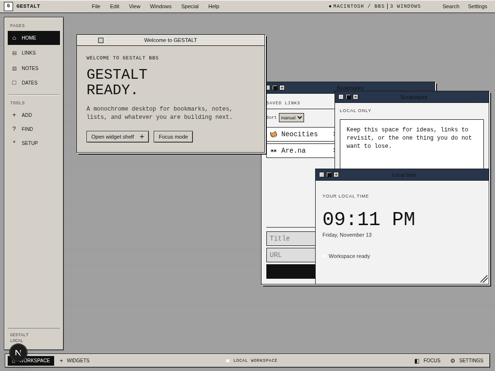
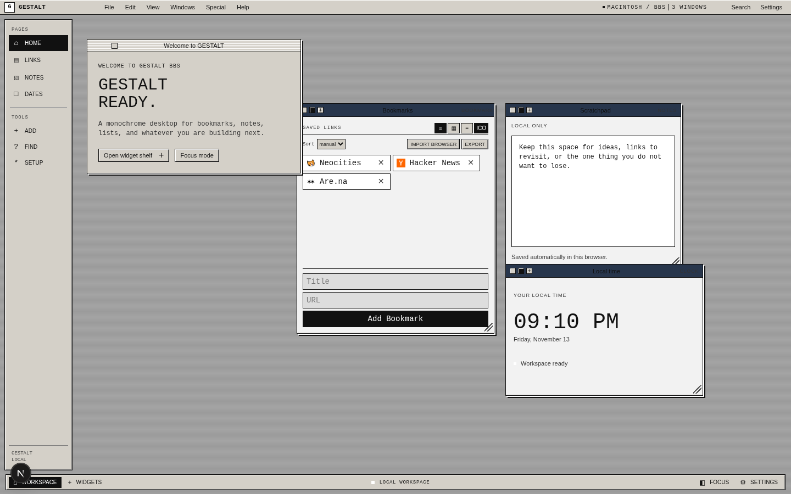

# GESTALT

<p align="center">
  
</p>

<p align="center">
  GESTALT is an experimental browser desktop and customizable start-page interface built with Next.js. It presents bookmark tools as draggable, resizable windows and supports switchable visual themes with locally persisted UI state.
</p>

## Screenshots

<table>
  <tr>
    <td align="center">
      
      <br>
      <sub>Bookmark desk in retro Macintosh OS style</sub>
    </td>
    <td align="center">
      
      <br>
      <sub>New tab page extension</sub>
    </td>
  </tr>
</table>

## Features

- Draggable, focusable, minimizable, and resizable desktop-style windows
- Bookmark widget with locally persisted entries
- Rotating ASCII art widget sourced through a server-side ASCIIArt.eu proxy
- Cellular automata widget with configurable rule, speed, density, cell size, palette, and grid
- Winamp-style local audio player with playlist controls and local `.wsz` / image skin loading

## Browser extension packaging

Gestalt includes self-contained Manifest V3 browser extensions for Chrome and Firefox. The extension has its own local bookmark desk, saves the active tab, supports JSON import/export, and adds a “Save page to GESTALT” context-menu action. An optional web-app URL can open a hosted Gestalt workspace.

Run `npm run extension:package`. This creates loadable directories plus upload-ready ZIP archives: `dist/gestalt-chrome-0.1.0.zip` for Chrome Web Store and `dist/gestalt-firefox-0.1.0.zip` for Firefox Add-ons. For local testing, load `dist/extension-chrome` as unpacked in Chrome or `dist/extension-firefox` through Firefox’s `about:debugging` page.

Store submission notes and permission/privacy copy live in `extension/privacy.html`; use the repository page as the privacy-policy URL when completing the store listing.
- Switchable visual themes
- Responsive full-screen canvas
- Client-side state powered by Zustand

## Run locally

Requirements: a current Node.js release and npm.

```bash
npm install
npm run dev
